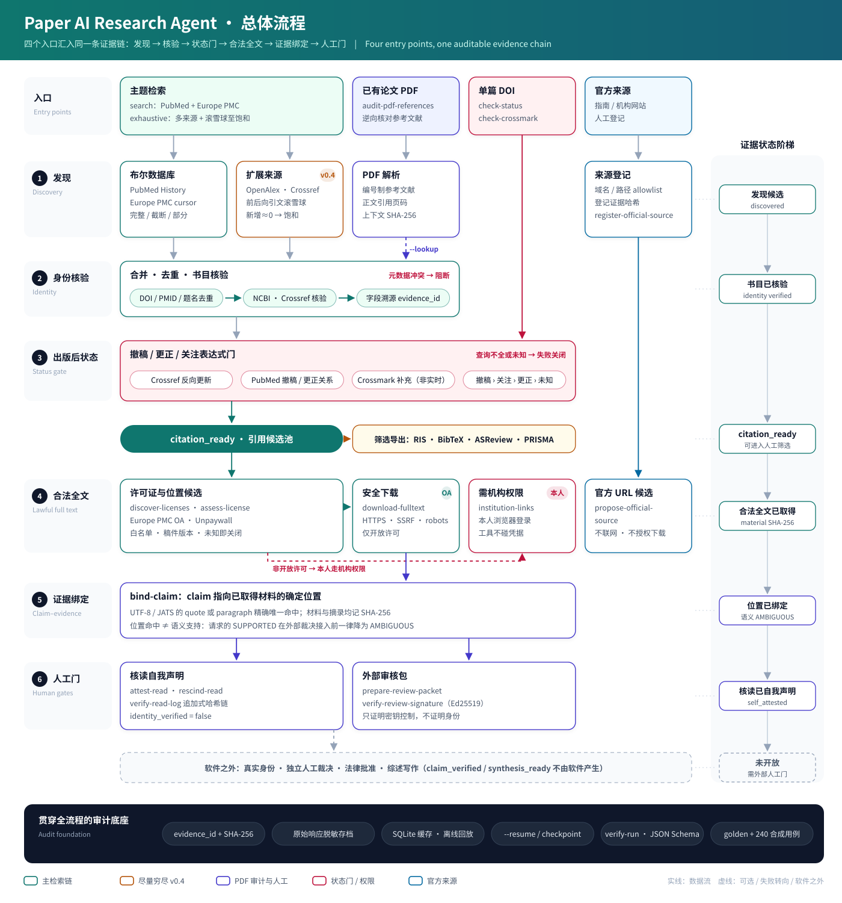
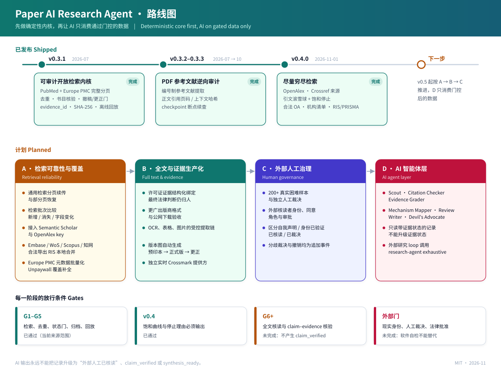

# Paper AI Research Agent

<p align="center">
  <a href="README.md">简体中文</a> · <a href="README.en.md">English</a>
</p>

<p align="center">
  
</p>

<p align="center">
  <strong>开放文献发现，证据状态可审计，关键门槛失败关闭。</strong>
</p>

<p align="center">
  <a href="https://github.com/TUANZIDING/Paper-AI-Research-Agent/actions/workflows/ci.yml"></a>
  
  
  <a href="LICENSE"></a>
</p>

Paper AI Research Agent 是一个基于开放学术 API 的本地、确定性文献检索内核。
它把“找到论文”“核对书目”“检查出版后状态”“保存证据”和“进入人工筛选”
拆成可审计的独立步骤。

> [!IMPORTANT]
> 本项目不绕过付费墙、登录、robots 或机构权限；不等价替代 Embase、Scopus、
> Web of Science；`citation_ready=true` 也不代表已阅读全文、研究结论可靠或系统综述检索完整。

## 总体流程

<p align="center">
  
</p>

四个入口（主题检索、已有论文 PDF、单篇 DOI、官方来源）汇入同一条证据链：**发现 → 身份核验 → 出版后状态门 → `citation_ready` → 合法全文 → claim–evidence 位置绑定 → 人工门**。每升一级都有对应命令和失败关闭条件；`claim_verified` / `synthesis_ready` 不由软件产生。

| 层 | 命令 | 核心模块 |
|---|---|---|
| 发现与核验 | `search` | `sources.py` · `pipeline.py` · `publication_status.py` |
| 单篇出版后状态 | `check-status` · `check-crossmark` | `publication_status.py` · `crossmark.py` |
| 尽量穷尽检索 | `exhaustive` | `exhaustivev04.py` · `snowballv04.py` · `openalexv04.py` · `crossrefsearchv04.py` · `europepmcgraphv04.py` |
| 合法全文 | `exhaustive`（OA 分诊）· `download-fulltext` · `discover-licenses` | `openaccessv04.py` · `fulltext.py` · `license_policy.py` |
| 机构权限（本人） | `institution-links --open-login` | `institutionv04.py` |
| 证据与回放 | `verify-run` · `--cache-db --offline-replay` | `archive.py` · `cache.py` · `replay.py` |
| 导出 | `exhaustive` 自动生成 | `exportv04.py`（RIS / BibTeX / ASReview CSV / PRISMA） |
| PDF 逆向审计 | `audit-pdf-references` | `pdf_audit.py` · `reference_batch.py` |
| 官方来源候选 | `register-official-source` · `propose-official-source` | `official_sources.py` |
| 证据绑定 | `bind-claim` | `claim_evidence.py` |
| 人工门 | `attest-read` · `rescind-read` · `verify-read-log` · `prepare-review-packet` · `verify-review-signature` | `human_read.py` · `external_review.py` |
| 可靠性评测 | 测试套件 | `evaluation.py`（golden seed + 240 条合成用例） |

## v0.4 尽量穷尽检索（`exhaustive`）

```bash
export RESEARCH_AGENT_EMAIL="你的联系邮箱"   # Unpaywall 需要；只走环境变量，不写入归档
export OPENALEX_API_KEY="可选"                # 无 key 时 OpenAlex 可能 HTTP 429，会记为来源问题而非 0 条
research-agent exhaustive '<PubMed 布尔检索式>' \
  --source-query 'europe_pmc=<Europe PMC 检索式>' \
  --source-query 'openalex=radiation-induced skeletal muscle injury' \
  --require 'radiat*|irradiat*|radiotherap*' \
  --require 'muscle*|myopath*|myoblast*' \
  --all --max-seeds 30 --max-rounds 3 --output runs
```

边界：
- 每轮记录 frontier、前/后向链接数、新增唯一候选、新增相关、截断与错误；到最大轮数仍有新增时标记 **未饱和**。
- **饱和不等于系统综述检索完整**：仍需 Embase、Scopus、Web of Science、中文数据库、灰色文献和人工筛选。
- 只下载 CC BY / CC BY-SA / CC0 / 公有领域许可的开放全文；其余列入“需机构权限”清单，经机构权限、馆际互借或联系作者获取。不绕付费墙、登录或 robots。
- 排除规则：`--exclude 'low-level laser|photobiomodulation'` 剔除明显误命中（如低能量激光），`--exclude-unless 'ionizing|radiotherap*'` 让同时提到电离辐射/放疗的记录仍保留；被剔除的记录在 `auto-excluded-v0.4.csv` 中单独标注 `exclusion_rule`，报告给出条数。
- 每轮候选上限：`--max-candidates-per-round`（默认 5000）；某轮新增唯一候选超过上限时会截断并记录，大主题可提到 10000。
- ASReview CSV 的 `included` 列留空，由人工判定。Semantic Scholar 尚未接入。

### 机构权限（只给你自己的账号用）

`needs-institutional-access` 清单可以按**你自己机构**的访问档案生成手动核对页 `institutional-access-v0.4.html`：每篇文献给出该出版平台的 CARSI/Shibboleth 联邦登录入口和 DOI 链接；没匹配到的走 WebVPN 或馆际互借。

```bash
cp profiles/institution-profile-example-v0.4.json ~/.config/research-agent/my-institution-v0.4.json  # 填入你所在图书馆公布的入口链接
export RESEARCH_AGENT_INSTITUTION_PROFILE=~/.config/research-agent/my-institution-v0.4.json
research-agent exhaustive '...' --require '...'            # 运行时自动套用
research-agent institution-links runs/exhaustive-...        # 或对已有运行重新生成
```

- 长任务可断点续跑：加 `--cache-db runs/cache.sqlite --resume`，用同一命令重跑时已缓存的响应直接复用，只补抓缺失部分。
- 个人使用：`research-agent institution-links <运行目录> --open-login` 会在你自己的浏览器里弹出所需平台的机构登录页（CARSI/WebVPN），账号密码在学校页面上由你本人输入，工具不接触；`--open-articles N` 再逐篇打开（每篇按回车，最多 20 篇）。
- 档案**不含任何账号、密码、Cookie 或令牌**，含这类字段会被拒绝；档案放在仓库外，路径不写入 manifest。
- 工具**不登录、不保存会话、不通过机构权限自动下载**。逐篇由有权限的本人打开（可配合 Zotero Connector）；图书馆许可普遍禁止用软件批量下载。
- 其他人使用本项目时，需要提供**自己订阅机构**的档案；仓库只附通用示例。

详见 [v0.4 尽量穷尽检索说明](docs/EXHAUSTIVE-RETRIEVAL-v0.4.md)。

## 能力状态

| 状态 | 能力 | 准确边界 |
|---|---|---|
| 已实现 | PubMed、Europe PMC 检索与完整分页状态 | 显式报告 `complete`、`truncated` 或 `partial` |
| 已实现 | DOI/PMID/题名去重与 NCBI/Crossref 书目核验 | 元数据冲突失败关闭 |
| 已实现 | Crossref 与 PubMed 出版后状态门 | 风险信号或查询不完整会阻断引用候选 |
| 已实现 | 原始响应存档、`evidence_id`、SHA-256、`verify-run` | 验证当前 manifest 与文件一致性 |
| 已实现 | SQLite 内容寻址缓存与严格离线回放 | 缓存缺失不会联网回退 |
| 受限实现 | 编号制 PDF 参考文献提取与正文引用位置映射 | 仅支持明确标题和连续 `[1]..[n]`；位置不等于语义支持 |
| 受限实现 | PDF 参考文献查询批次的断点续跑 | 已完成条目跳过，未完成/部分/失败条目可重试；不是通用分页续传 |
| 受限实现 | 官方组织域名/路径的人工登记候选 | 显式 allowlist 与已哈希登记证据只产生候选；不证明官网身份或下载许可 |
| 受限实现 | 许可证/全文位置候选与策略门控的公开全文下载 | 候选不是法律授权；需白名单许可证、已知版本及全部安全门 |
| 受限实现 | Crossref 状态补充 fallback | `crossmark_realtime_verified=false`，不是实时 Crossmark 核验 |
| 受限实现 | 已哈希 UTF-8/JATS 文本的 quote/paragraph 位置绑定 | 位置命中不等于语义支持或 `claim_verified` |
| 外部门未完成 | 现实身份、实际人工核读、最终法律批准 | Ed25519 仅证明给定密钥控制 |
| 外部门未完成 | 200+ 独立人工裁决黄金集 | 现有 240 条是合成契约/对抗用例，`human_adjudicated=false` |

完整门槛见 [分阶段验收门](docs/ACCEPTANCE_GATES.md)。

## 快速开始

要求 Python 3.10+。网络与审计内核使用标准库，PDF 文本提取使用 `pypdf`，安装项目时会自动安装。

```bash
python3 -m venv .venv
. .venv/bin/activate
python3 -m pip install -e .

research-agent search '"diabetic osteoporosis" AND osteoblast' --limit 10
```

每次检索写入独立、不覆盖的目录；默认存档模式包含：

```text
runs/<UTC时间>-<查询词>/
├── manifest.json
├── records.jsonl
├── report.md
└── raw_responses/
```

核验一次运行：

```bash
research-agent verify-run /absolute/path/to/run-directory
```

逆向审计一篇本地 PDF（默认仅解析，不联网）：

```bash
research-agent audit-pdf-references /absolute/path/to/article.pdf \
  --output /absolute/path/to/pdf-audits

# 明确允许后，才逐条查询 PubMed 与 Europe PMC，并归档远端原始响应
research-agent audit-pdf-references /absolute/path/to/article.pdf \
  --lookup --cache-db /absolute/path/to/http-cache.sqlite3 \
  --output /absolute/path/to/pdf-audits

# 可先对困难条目做小批量真实查询
research-agent audit-pdf-references /absolute/path/to/article.pdf \
  --lookup --lookup-references 1,46,59 --limit-per-reference 5

# 本轮最多处理 10 个未完成条目；再次使用同一 checkpoint 可继续
research-agent audit-pdf-references /absolute/path/to/article.pdf \
  --lookup --lookup-references 1-75 --max-items 10 \
  --checkpoint /absolute/path/to/reference-checkpoint.jsonl \
  --cache-db /absolute/path/to/http-cache.sqlite3
```

checkpoint 是带事件哈希链的追加式进度账本，并绑定所选编号与输入载荷。篡改、截断
或复用到不同输入会失败关闭。它只恢复逐条书目查询，不恢复 PDF 提取，也不实现
普通 `search` 命令的中断分页续传。
批次仍为 `partial`、`failed` 或 `pending` 时，命令保留产物并返回退出码 3；只有全部
所选条目的查询链达到 `completed` 才返回 0。

产物包含 PDF 哈希、结构化参考文献、正文引用页码/短上下文及哈希、候选匹配分数、
原始 API 响应和 manifest。自动结果始终保留
`semantic_support_status=NOT_ASSESSED`、`human_adjudicated=false`；详见
[PDF 参考文献审计边界](docs/PDF_REFERENCE_AUDIT.md)。

严格离线回放：

```bash
research-agent search 'YOUR QUERY' --limit 10 \
  --cache-db /absolute/path/to/http-cache.sqlite3 \
  --output /absolute/path/to/online-runs

research-agent search 'YOUR QUERY' --limit 10 \
  --cache-db /absolute/path/to/http-cache.sqlite3 \
  --offline-replay \
  --output /absolute/path/to/replay-runs
```

许可证候选与安全全文命令：

```bash
research-agent discover-licenses --crossref /absolute/path/to/crossref.json

research-agent download-fulltext \
  --url 'https://repository.example/article.xml' \
  --license 'CC BY 4.0' \
  --version publishedVersion \
  --output /absolute/path/to/article.xml
```

下载器会检查许可证白名单、稿件版本、HTTPS、DNS/IP、SSRF、同源重定向、
robots、总时限、大小、PDF/JATS XML 结构及原子落盘。PDF 还需要本机 `pdfinfo`；
任一门不满足即停止。

登记官方来源候选（不联网，也不授权下载）：

```bash
research-agent register-official-source \
  --organization-id example-guideline-body \
  --organization-name 'Example Guideline Body' \
  --hostname guidance.example.org --path-prefix /standards \
  --registrar-role 'information governance reviewer' \
  --evidence-source-url 'https://registry.example.org/entry' \
  --evidence-file /absolute/path/to/registry-evidence.txt \
  --observed-at '2026-07-27T10:00:00+08:00' \
  --output /absolute/path/to/official-source-evidence

research-agent propose-official-source \
  --registration-bundle /absolute/path/to/official-registration-SHA256.json \
  --organization-id example-guideline-body \
  --url 'https://guidance.example.org/standards/item' --title 'Guideline title' \
  --output /absolute/path/to/official-source-evidence
```

## 信任模型

- 摘要、全文、网页、附件和远端元数据始终按不可信输入处理。
- `citation_ready` 只表示可进入下一步人工筛选。
- `unknown` 不会被改写为“安全”或“已排除撤稿”。
- 许可证发现只生成候选，不提供最终法律意见。
- claim 的位置绑定不证明科学结论真实，也不证明语义蕴含。
- 自我声明哈希链不证明现实身份；外部签名只证明密钥控制。
- 开放源覆盖不等于商业数据库覆盖或系统综述无遗漏。
- 网页自称“官方”不会升级状态；官方来源候选不证明域名控制、内容最新、法律许可
  或人工核读，且当前固定 `network_fetch_permitted=false`。

## 验证

```bash
PYTHONPATH=src python3 -m unittest discover -s tests -v
python3 scripts/verify_release.py
python3 -m compileall -q src scripts tests
```

2026-07-26 快照：测试数以当前 CI 输出为准；6 条 golden seed；另有 240 条
确定性合成契约/对抗用例。后者不是独立人工裁决黄金集。

## 路线图

<p align="center">
  
</p>

下一步按 **A 检索可靠性与覆盖 → B 全文与证据生产化 → C 外部人工治理** 推进，**D AI 智能体层**只消费已过门数据。详见 [实施路线](docs/ROADMAP.md)。

## 尚未完成

1. 许可证候选的最终法律/政策判断与跨法域批准；
2. 更广发布商格式和可控公网环境的全文下载验收；
3. OCR、表格、图片和全文语义的受控 claim-evidence 派生链；
4. 200+ 真实困难样本及独立人工标注/裁决；
5. 外部真实人工核读、现实身份、专业独立性、同意和审批；
6. 预印本、接受稿、正式版与更正稿版本图自动生产；
7. 通用检索中断分页续传、部分页恢复、检索批次比较和独立实时 Crossmark 提供方。

## 文档

- [数据源与合法边界](docs/SOURCE_POLICY.md)
- [v0.4 尽量穷尽检索](docs/EXHAUSTIVE-RETRIEVAL-v0.4.md)
- [分阶段验收门](docs/ACCEPTANCE_GATES.md)
- [实施路线](docs/ROADMAP.md)
- [Claim–Evidence 位置绑定](docs/CLAIM_EVIDENCE.md)
- [PDF 参考文献审计边界](docs/PDF_REFERENCE_AUDIT.md)
- [Crossmark 补充覆盖政策](docs/CROSSMARK_POLICY.md)
- [人工核读、身份与法律判断边界](docs/HUMAN_AND_LEGAL_GATES.md)
- [主视觉来源与使用边界](docs/ASSET_PROVENANCE.md)

## 许可证

[MIT](LICENSE)。论文全文、远端元数据和第三方内容仍分别受其原始条款约束。
